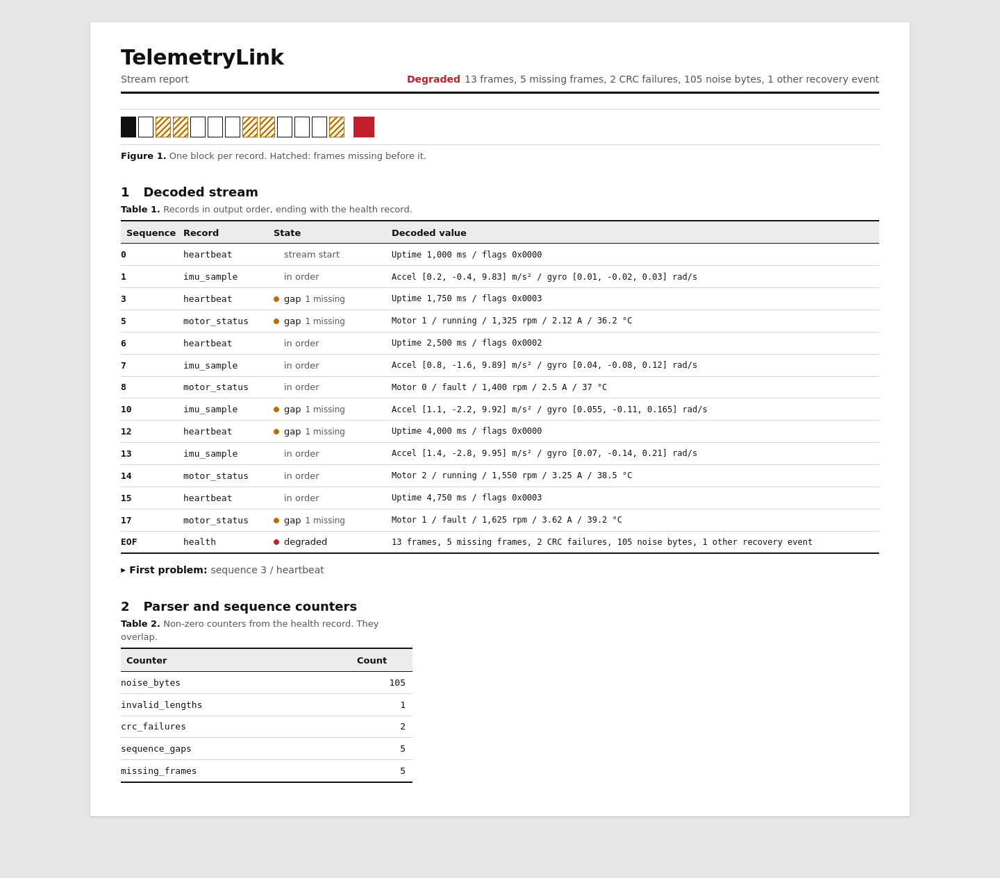

# TelemetryLink

TelemetryLink is a dependency-free C++20 library and command-line decoder for
v1 embedded telemetry frames. It accepts files or stdin in arbitrary-sized
chunks, recovers after damaged input, and writes one JSON object per line for
each decoded message followed by a stream-health record.

Use the library when a program already owns the incoming byte stream, or use the
CLI to inspect, redirect, archive, and render recorded data. The supported typed
payloads are heartbeat, IMU sample, and motor status. The exact wire format is
documented in [protocol.md](protocol.md).

## Decoder behavior

Embedded-link reads do not need to align with application frames. The parser
retains partial magic and incomplete frames across `feed()` calls, emits every
complete frame, and handles concatenated frames, line noise, invalid lengths,
bad checksums, and sequence discontinuities.

- The wire format uses explicit little-endian encoding and CRC-32/ISO-HDLC.
- Recovery advances one byte at a time after noise, invalid headers, wrong
  lengths, or CRC failures.
- Sequence health uses a global `uint32` value with wraparound, inferred gaps,
  and out-of-order detection. Out-of-order frames do not move the sequence
  high-water mark backward.
- CRC-valid semantic payload errors consume their known frame boundary.
- A valid frame produces one message record. Reaching EOF produces one health
  record containing type totals, parser counters, and status.

## Build

Requirements: CMake 3.20+, a C++20 compiler, and Python 3.8+ for the stream
simulator and report renderer.

```sh
cmake -S . -B build -DCMAKE_BUILD_TYPE=Release
cmake --build build --parallel
```

## Decode a stream

### Decode generated input from stdin

This command generates nine frames and streams them directly into the decoder.
The output contains three typed message shapes followed by an `ok` health
record:

```sh
python3 tools/simulate.py --scenario normal --count 9 | ./build/telemetry-link
```

The CLI decodes and flushes live input without waiting for EOF. EOF is needed
only for the final health record.

### Recover a damaged stream and render a report

This workflow creates a damaged binary stream, preserves the decoder's complete
JSONL output, displays an optional diagnostic summary on stderr, and renders the
recorded run as an HTML diagnostic report:

```sh
python3 tools/simulate.py --scenario mixed --count 18 --output mixed.bin
./build/telemetry-link --diagnostics mixed.bin > mixed.jsonl
python3 tools/render_report.py mixed.jsonl --output docs/demo-report.html
```

Open `docs/demo-report.html` in a browser. The report is a compact reader for the
recorded JSONL: it keeps decoded messages in CLI output order, focuses the first
sequence anomaly, shows the focused record as structured fields and raw JSON,
and attaches parser recovery counters to the final health record. It is not a
second decoder and does not change the stdout contract.

Sequence gaps are localized to the affected decoded record. CRC and noise
positions are not present in the JSONL contract, so the reader reports those
values as EOF counters rather than inventing packet or byte positions.

[](docs/demo-report.html)

`--diagnostics` writes a concise human summary to stderr while stdout remains
valid JSON Lines. Diagnostic color is controlled by
`--color auto|always|never` (default: `auto`), and `NO_COLOR` is respected.

For automation that should reject detected link damage after still receiving the
health record, add `--fail-on-degraded`:

```sh
./build/telemetry-link --fail-on-degraded mixed.bin
```

The other scenarios are `dropped` and `corrupted`. Use at least four logical
frames when demonstrating them: scheduled damage begins at index 2, and a
dropped tail is not observable until a later sequence arrives.

## JSON Lines output contract

The CLI writes JSON Lines and nothing else to stdout. This makes a decoded run
safe to redirect, pipe, diff, or archive. Human diagnostics stay on stderr.

| Record | When emitted | Key content |
| --- | --- | --- |
| `"kind":"message"` | Once for every successfully decoded frame | Version, sequence state, typed payload |
| `"kind":"health"` | Once when input reaches EOF | Type totals, parser counters, and `ok` or `degraded` status |

`expected_sequence` is present after the first frame. `missing_before` is present
only when a gap is detected. Non-finite wire floats are serialized as JSON `null`
so every line remains valid JSON.

`"status":"ok"` means no anomaly was detected; it is not a liveness signal.
Empty input is therefore `ok`, and a frame dropped at the very end cannot be
inferred without a later sequence number. Recovery counters are diagnostic
events rather than a partition of input bytes, so a failed candidate can also
contribute bytes to `noise_bytes` while the parser searches for the next magic.

### Exit status

| Code | Meaning |
| ---: | --- |
| `0` | Decode and output completed. Degraded input still returns 0 by default. |
| `1` | Input or output failure. |
| `2` | Invalid command-line usage. |
| `3` | Damage was detected and `--fail-on-degraded` was requested. |

## Library integration

TelemetryLink is dependency-free, installs as a static library, and exports a
CMake config package:

```sh
cmake -S . -B build-package -DCMAKE_BUILD_TYPE=Release
cmake --build build-package --parallel
cmake --install build-package --prefix /desired/prefix
```

Consume it with the exported target:

```cmake
find_package(TelemetryLink 1 CONFIG REQUIRED)
target_link_libraries(my_target PRIVATE TelemetryLink::telemetry_link)
```

An `add_subdirectory` consumer gets only the library unless it opts into the
command-line decoder.

## Recovery trade-off

After a candidate has a plausible header, the parser waits for its declared
frame bytes before checking CRC. It does not jump early to `TLNK` found inside
the candidate because those bytes are legal payload. This favors correctness
over earliest possible recovery from a false magic.

Exact v1 schema lengths are the tighter bound today: the largest accepted v1
candidate is the 40-byte IMU frame. The configurable ceiling cannot exceed the
protocol's 1,024-byte limit.

## Boundaries and limitations

- Protocol v1 supports only the three fixed schemas and rejects unknown versions
  and message types; there is no extension-envelope pass-through.
- A device reboot that resets sequence numbers needs a new parser or `reset()`;
  it cannot be inferred safely from old or out-of-order traffic alone.
- CRC detects accidental corruption but provides no authenticity or encryption.
- IEEE-754 NaN and infinity can exist on the wire; the CLI writes them as JSON
  `null` so every output line remains valid JSON.
- The CLI intentionally supports files and stdin only. It has no serial-port,
  ROS, networking, GUI, or device-management layer.
- A parser instance is stateful and not internally synchronized. Use one
  instance per stream and provide external synchronization if threads share it.
- `feed()` copies the supplied chunk and returns all frames decoded from it.
  Callers that need bounded peak memory should use bounded chunks; the CLI uses
  4,096-byte chunks. `finish()` and `reset()` release retained input storage.
- Moving a parser transfers its buffered frame, sequence history, and statistics.
  The moved-from parser is reset and may be reused.
